<div align="center">

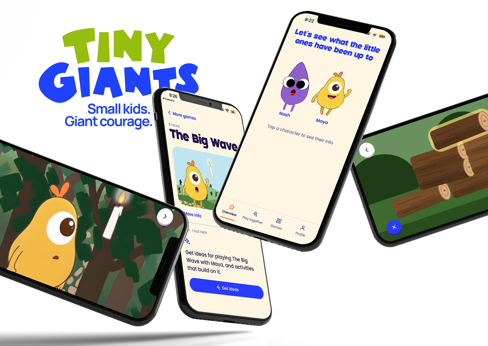

<br/>

# Tiny Giants

### An interactive storybook app that helps young children understand and manage big feelings

**Type of solution:** Cross-platform mobile app (iOS, Android and Web) with a serverless AI back end
**By:** Danae Swart

<br/>


**Try it live:** [tiny-giants-178da.web.app](https://tiny-giants-178da.web.app/) (scan the QR code, then tap the demo button on the login page)

<br/>


</div>

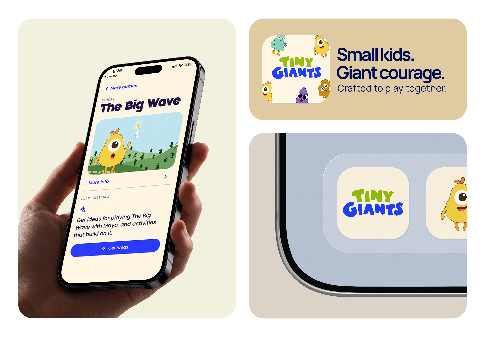

---

<details>
<summary><strong>Table of contents</strong></summary>

1. [About the project](#about-the-project)
2. [The problem and the solution](#the-problem-and-the-solution)
3. [Research and UX case study](#research-and-ux-case-study)
4. [Who it is for (users and personas)](#who-it-is-for)
5. [Features](#features)
6. [Built with](#built-with)
7. [Getting started](#getting-started)
8. [System architecture](#system-architecture)
9. [Project structure](#project-structure)
10. [How the components interact](#how-the-components-interact)
11. [Navigation and routing](#navigation-and-routing)
12. [The game engine](#the-game-engine)
13. [The Big Wave: scene by scene](#the-big-wave-scene-by-scene)
14. [Data model (ER diagram)](#data-model)
15. [Security and privacy](#security-and-privacy)
16. [The AI parent coach](#the-ai-parent-coach)
17. [Design](#design)
18. [Use cases](#use-cases)
19. [Key code snippets](#key-code-snippets)
20. [Challenges and how they were solved](#challenges-and-how-they-were-solved)
21. [Testing and quality](#testing-and-quality)
22. [Deployment](#deployment)
23. [Diagram library](#diagram-library)
24. [Conclusion and future work](#conclusion-and-future-work)
25. [License, author and acknowledgements](#license)

</details>

---

## About the project

**Tiny Giants** is a children's emotional-learning app. Each game is a short, captioned
storybook adventure that teaches one coping skill, such as paced breathing, small-steps
thinking or noticing kind actions. The tagline is **"Small kids. Giant courage."**

The app has two sides that share one account:

| Side | Who uses it | Orientation | What it does |
|------|-------------|-------------|--------------|
| **Child side** | The child (aged 4 to 5) | Landscape | A friendly "Hi, Name!" home with one big **All games** button, picture tiles for the enabled games, a large Play button, then the story game itself |
| **Parent side** | The grown-up | Portrait | Dashboard, choose which games are on for each child, play history, AI suggestions for playing together, account settings |

A **4 digit parent PIN** separates the two sides, so a child cannot wander into settings.

The first game, **The Big Wave**, teaches stress management. A little hero called Cami
walks through the woods to the beach. Along the way the child blows out a candle into the
microphone, clears logs from the path, jumps obstacles, builds a sandcastle and finally
breathes together with the waves. The lesson lands at the end: the calm was inside Cami
all along, the candle was only a reminder.

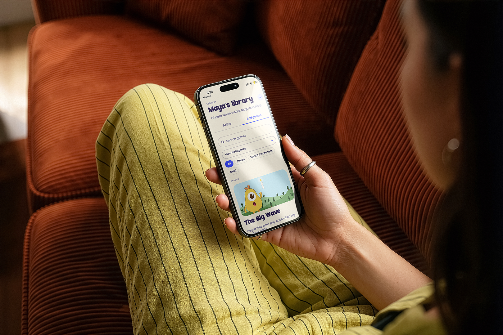

## The problem and the solution

**The problem**
- Young children often cannot name big feelings, so stress shows up as tantrums, shutdowns or tears.
- Parents want simple, low-pressure tools to talk about feelings, but most apps are built for entertainment, not for emotional learning.
- Screen time for small children needs to be calm, short and safe, with a parent in control.

**The solution**
- Short captioned storybook games that each teach one skill through play, not through lectures.
- A child-safe interface: large touch targets, no small text, very few choices at once.
- A parent side that gives control (which games, which child), visibility (what was played) and support (an AI coach that suggests how to play together and what to say afterwards).

**Design principles**

1. One skill per game, taught by doing it (breathe, blow, take small steps).
2. The parent is always in control, the child is never overwhelmed.
3. Nothing the child says is recorded. The microphone is only used to read loudness.
4. Secrets stay on the server. Data access is locked down by rules, not by hope.

## Research and UX case study

The full UX case study (problem framing, research, personas, game blueprint and annotated wireframes) shaped every decision in the app. The key pieces are summarised here.

### Problem framing

> **A four-year-old can count to ten. But can they calm themselves down?**

Kids' app stores are wall to wall letters, numbers and shapes. Almost nothing teaches a child what to do when their chest goes tight. Children aged 4 to 5 have big feelings, no vocabulary for them and no tools to cope, and their parents often lack the words, the time or the access to professional support.

**How might we** help a child aged four to five build emotional intelligence and real coping tools through play, while giving their parent a genuine role in that process, not just visibility into it?

**The pivot.** Early drafts did not mention the parent at all. Research showed that 4 and 5 year olds whose parent played an educational app with them did meaningfully better than kids who played alone (Griffith et al., 2021). The project became something built for **two people from the start**: a child game plus a parent companion.

### The numbers behind it

| | | |
|:---:|:---:|:---:|
| **36**<br/>4 to 5 year olds described different coping responses | **1 in 10+**<br/>children has a diagnosable, treatable mental health condition (UCT, 2023) | **9 / 10**<br/>South African children with a diagnosable condition have no real way to get treated |
| **15**<br/>child and adolescent psychiatrists in the entire public healthcare system (UCT, 2023) | **3 of 9**<br/>provinces have any child psychiatrists in the public sector (Docrat et al., 2019) | **1 : 10,633**<br/>psychologists to people who would need one (PsySSA, 2025) |

### Research findings that became design decisions

| Finding | Source | Design decision |
|---------|--------|-----------------|
| Children this age cope **worse** in situations they can control and **better** in ones outside their hands | Yeo et al., 2014; Band and Weisz, 1988 | The hard moments (the fall, the wave) happen to the character, not as a child failure. The log pile is kept deliberately small |
| Guided breathing **shown through simple imagery**, not told, lowered physical stress | Obradovic et al., 2021 | A growing and shrinking circle and a candle teach breathing without instructions |
| Small, completed wins build a child's belief they can cope | Bandura, 1977 | Every scene ends on a small win. Logs can only be removed **one at a time** |
| Teacher interview: breathing is her main classroom tool, and "baby steps" is her phrase for breaking a task down | Teacher interview | Breathing is the core skill. The "baby steps" scene and one-log-at-a-time game come straight from her words |
| Parents lack specifics, not motivation | Griffith et al., 2021 | The Play together coach tells a tired parent exactly when and how to join in |
| Four to five year olds feel before they can name a feeling, and are not reading yet | Simply Psychology; Yeo et al., 2014 | Feelings are shown in Cami's body and never named in the game. Everything is icon and picture led |

### Game design blueprint: the pattern

**Invest, then a big feeling, then breathe with Cami, then the moment passes.** The pattern repeats across controllable moments (the log pile) and uncontrollable ones (the fall, the wave) so the skill transfers. The emotions are never named in the game on purpose. That gap is the parent's cue to join in and talk about it.

| Stage | Scenes | Purpose |
|-------|--------|---------|
| Investment | Introduction, Building the sandcastle | A child who cares stays with the story when the challenge arrives |
| Big feeling | Edge of the woods | Shows stress in the body without naming it |
| Coping skill | Breathe with Cami | Introduces paced breathing through the candle |
| Interactive | Forest path, Clearing the logs, Jumping the logs | Hands-on play between story beats |
| Big feeling + breathe | Log pile, The fall | Practise the skill after different kinds of hard moments |
| Strategy | "Baby steps" | Pair calming down with a plan |
| Calm | Arrival at the beach | A deliberate breather before the biggest moment |
| Biggest feeling + breathe | The wave | The deepest practice, **without the candle** |
| Resolution | The ending | "The magic is in me too." The skill is handed to the child |

**Playing together** (suggested by the parent coach): *Before*, pause at each big feeling and ask what your child thinks Cami feels. *During*, the unnamed emotions are the cue to talk. *After*, replay the log pile and ask "Have you ever felt like something was too big to do all at once?"

### Parent app flows (from the annotated wireframes)

| Flow | What it does | Design insight |
|------|--------------|----------------|
| **1. Parent dashboard** | Each child appears as the character they picked. Tap one to see active games, the skills practised and recent plays | Skills are shown as practice, never scores or comparisons between siblings. A worried parent should leave more equipped, not more anxious |
| **2. Add a game to a child's view** | Overview, Library, pick a child, game details, Activate | Every game states what it teaches before it is switched on. Nothing reaches the child until a parent chooses it |
| **3. Playing together** | Pick a child and game, tap Get ideas, receive a plan with when to join in and follow-up activities | The biggest pivot: from managing access to giving ideas. Every answer is labelled "AI suggestions, not professional advice" |
| **4. Settings and account** | Edit children, account settings behind the PIN, sign out and delete kept apart in "the no-no zone" | The PIN keeps account changes away from small hands without adding friction to everyday use |

### Child app flows

| Flow | What it does | Design insight |
|------|--------------|----------------|
| **5. Play a game** | "Hi, Maya!" then All games, pick a picture tile, Play, story, calming candle, "Great job!", Done | Every action is icon led because the child is not reading yet. The ending is a small completed win |
| **6. Child settings** | A small panel to switch who is playing, toggle skip buttons, or return to the parent dashboard behind the PIN | Families share one tablet. Switching child is a single tap on a character |

### Try it

**Live prototype:** https://tiny-giants-178da.web.app/

On the login page, tap the **demo** button to view the app as if someone has already been using it (two children and their play history are filled in).

<!-- Optional visuals: export pages of the case study PDF as images and place them in docs/readme-images/, for example
     case-study-problem.png, case-study-personas.png, case-study-blueprint.png, case-study-flows.png, then embed them here with
      -->

## Who it is for

| Persona | Who | Needs | How Tiny Giants helps |
|---------|-----|-------|-----------------------|
| **Noah, 5** (the child) | Goes quiet or physical before he has words for what is wrong. Being told to "calm down" does nothing. | Something shown, not told. A tool that does not need him to explain the feeling first. Mom nearby, doing it with him. Repetition until the tool is his own. | Story games where feelings are shown in the character's body, one breathing tool repeated across the story, big icon-led controls |
| **Sarah, 34** (the parent) | Searches for parenting help late at night after Noah is asleep. Professional help was never really an option. | Something free that does not quietly become a cost later. Something she can do with him, not hand to him. Simple enough for a tired Tuesday. | Free app, a Play together coach with concrete ideas, per child control, no scores or comparisons |
| **Educator or therapist** (secondary) | Wants tools that reinforce coping skills | Evidence-informed activities | Each game lists the skills it practises and how to reinforce them offline |

## Features

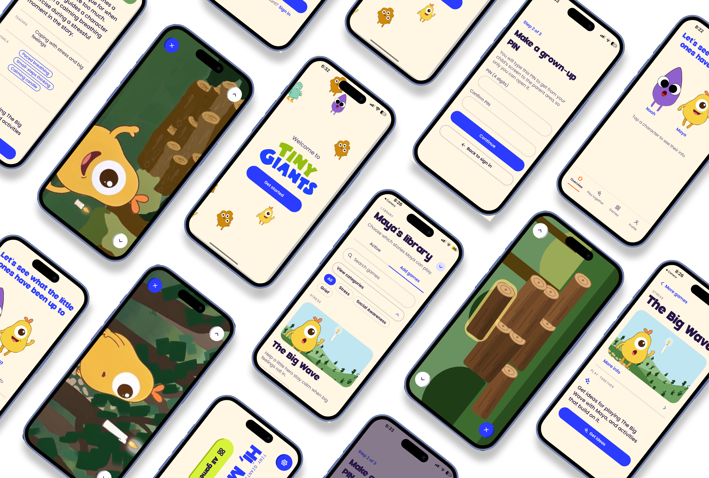

### Child side

| Feature | Description |
|---------|-------------|
| **Child home** | A personal greeting ("Hi, Maya!"), one big **All games** button and the child's chosen characters floating on the side. A settings button lets siblings switch who is playing. |
| **All games view** | Big picture tiles for only the games a parent has enabled, so a pre-reader can choose without reading. |
| **Game intro** | The game's cover art, its title and one large Play button. |
| **Interactive story games** | Captioned scenes with video and stills, plus interactive moments: blow, drag, tap, jump and breathe. There is no voiceover. Captions are timed by reading time. |
| **Microphone blow detection** | The child blows on the phone to put out Cami's candle. Only loudness is read, never stored. If the mic is refused, the candle blows out by itself. |
| **Celebration popup** | A cheering popup at the end of the story before returning to the game page. |
| **Rotate prompt** | Gently asks the child to turn the device to landscape. |

### Parent side

| Feature | Description |
|---------|-------------|
| **Sign up, log in, demo account** | Email and password via Firebase Auth, with validation and friendly error messages. A shared demo account opens ready to explore. |
| **Onboarding** | New parents create a PIN, then add a first child (or skip and add later). |
| **Parent PIN gate** | Four digits stored as a salted SHA-256 hash. Five wrong tries locks the gate for 30 seconds. |
| **Dashboard** | Child title dropdown, stat bars, time this week ring, recent plays. |
| **Games library** | Search, category filter pills, game detail page with skills, a parent note, and an on/off switch per child. |
| **Play history** | Every time a child plays, finished or left early, a session is saved. Grouped by game with plays, completions and total time. |
| **AI suggestions for playing together** | For each game, a Gemini powered coach gives ideas for how to play with your child before, during or after the game, and answers follow-up questions. It is grounded in the game's design notes and labelled "AI suggestions, not professional advice". |
| **Child and account management** | Add or edit children (name, age, birthday, character), change name, email or password, delete the account and all data. |
| **Device settings** | A skip-forward and back switch for demos and testing, remembered between launches. |

### Games catalogue

| Game | Theme | Skills practised | Status |
|------|-------|------------------|--------|
| **The Big Wave** | Stress and big feelings | Paced breathing, small-steps thinking, calming candle | Playable |
| **The Kind Detective** | Social awareness and kindness | Reading body language, naming feelings, kind responses | Coming soon |
| **Memory Garden** | Remembering and loss | To be defined | Coming soon |


## Built with

<p>
  
</p>

| Layer | Technology | Why it was chosen |
|-------|------------|-------------------|
| App framework | [Expo](https://expo.dev) SDK 58, [React Native](https://reactnative.dev) 0.88, React 19 | One code base for iOS, Android and web, fast iteration with Expo Go |
| Language | Plain JavaScript (JSX) | Fast to write, keeps the project approachable |
| Navigation | [Expo Router](https://docs.expo.dev/router/introduction/) | File based routes, protected route groups for sign in |
| Animation and gestures | Reanimated 4, Worklets, Gesture Handler | Smooth 60fps drag, bounce and fade |
| Graphics | `react-native-svg` | The characters, candle, castle and logs are drawn in code, so they scale perfectly |
| Media | `expo-video`, `expo-audio` | Silent scene clips, and microphone loudness metering for the blow-out-the-candle moment |
| Device | `expo-screen-orientation`, `expo-crypto`, `expo-font`, `expo-splash-screen` | Landscape and portrait locking, PIN hashing, fonts, launch screen |
| Auth and database | Firebase Authentication and Cloud Firestore | Managed, secure, real time ready, rule based access |
| Local storage | AsyncStorage | Remember settings and which child is playing |
| AI coach back end | Cloudflare Worker, `jose`, Google Gemini API | The Gemini key never ships inside the app |
| Hosting | Firebase Hosting (web build from `expo export`) | Public demo link |
| Testing and linting | Jest (`jest-expo`), ESLint (`eslint-config-expo`) | Unit tests for validation and storage, consistent code |
| Design | Figma, a custom style guide in `docs/style-guide/` | Moodboard, palette, typography, wireframes |
| Fonts | Talina (display), Poppins (body), DM Mono | Friendly, readable, child appropriate |

## Getting started

This repository contains both the **app** and the **coach Worker** in `worker/`.

### Prerequisites

| Requirement | Version | Link |
|-------------|---------|------|
| Node.js | 20 or newer | https://nodejs.org |
| npm | comes with Node | |
| Expo Go (phone) | latest | [App Store](https://apps.apple.com/app/expo-go/id982107779) or [Google Play](https://play.google.com/store/apps/details?id=host.exp.exponent) |
| Firebase project | | https://console.firebase.google.com (enable Authentication with Email/Password, and Firestore) |
| Gemini API key (AI coach only) | | https://aistudio.google.com/apikey |
| Cloudflare account and Wrangler (to deploy the coach) | | https://developers.cloudflare.com/workers/wrangler/ |

### Install and run

1. **Clone**
   ```bash
   git clone https://github.com/danaeswart/Tiny-Giants.git
   cd Tiny-Giants
   ```
2. **Install**
   ```bash
   npm install
   ```
3. **Environment variables.** Copy `.env.example` to `.env.local` and fill in your Firebase web config and the coach URL.
   ```bash
   EXPO_PUBLIC_FIREBASE_API_KEY=...
   EXPO_PUBLIC_FIREBASE_AUTH_DOMAIN=...
   EXPO_PUBLIC_FIREBASE_PROJECT_ID=...
   EXPO_PUBLIC_FIREBASE_STORAGE_BUCKET=...
   EXPO_PUBLIC_FIREBASE_MESSAGING_SENDER_ID=...
   EXPO_PUBLIC_FIREBASE_APP_ID=...
   EXPO_PUBLIC_COACH_URL=https://tiny-giants-coach.<your-subdomain>.workers.dev
   ```
4. **Start**
   ```bash
   npm start
   ```
5. **Open it**
   - Phone: scan the QR code (Camera app on iPhone, Expo Go on Android). Both devices must share Wi-Fi, or use `npx expo start --tunnel`.
   - Browser: press `w`.
   - Emulator: press `i` (iOS) or `a` (Android).
6. **Optional: deploy the AI coach**
   ```bash
   cd worker
   npm install
   npx wrangler secret put GEMINI_API_KEY
   npx wrangler deploy
   ```
   Put the printed URL in `EXPO_PUBLIC_COACH_URL`.

### Useful scripts

| Command | Purpose |
|---------|---------|
| `npm start` | Start the Expo dev server |
| `npm run android` / `ios` / `web` | Start on a specific platform |
| `npm run lint` | Lint the project |
| `npm test` | Run Jest |
| `npx expo-doctor` | Diagnose dependency and config issues |

## System architecture

Tiny Giants is a **client with serverless back ends**. There is no server to maintain.

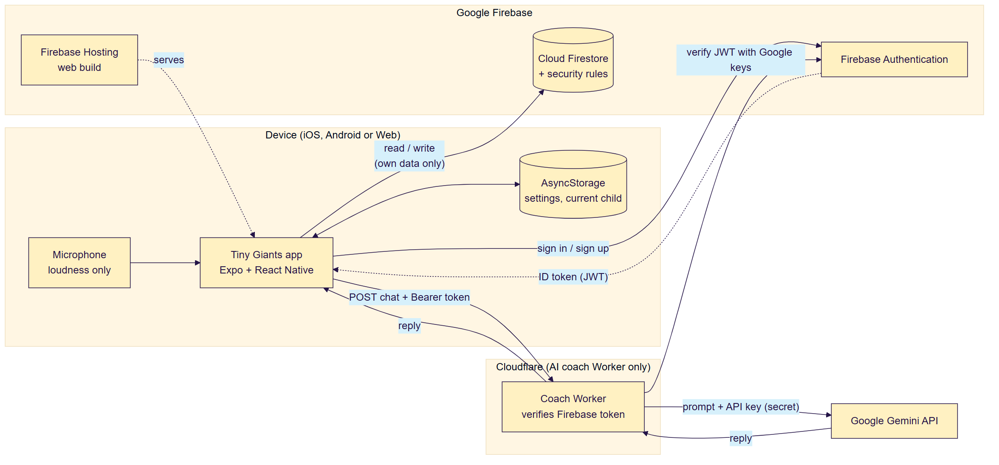

**Reading the diagram**
1. The app talks to **Firebase Auth** to sign in and receive an ID token.
2. The app reads and writes **Firestore** directly. Security rules make sure a parent only touches their own branch.
3. For the AI coach, the app sends the chat and the token to a **Cloudflare Worker**. The Worker verifies the token against Google's public keys, adds the secret Gemini key and calls **Gemini**.
4. The microphone never leaves the device. Only a 0 to 1 loudness number is used.
5. **Hosting.** The web app itself is hosted on **Firebase Hosting** at https://tiny-giants-178da.web.app/. Cloudflare is used only to run the small AI coach Worker, not to host the site.

### Layered code architecture

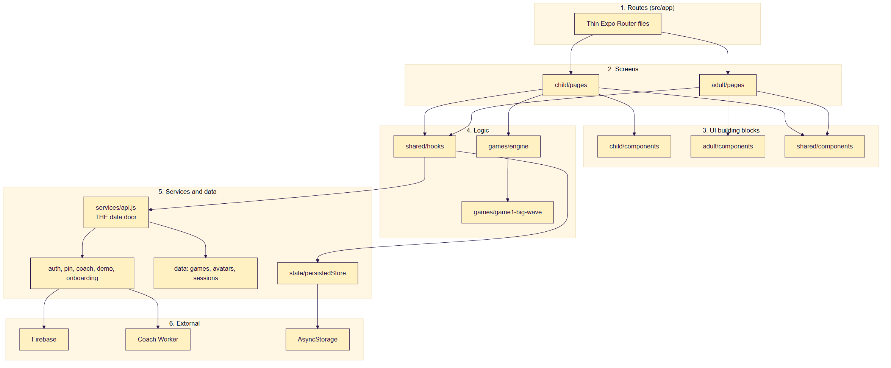

Each layer only talks to the layer below it. Routes never touch Firebase. Screens never read the data files directly.

## Project structure

```
Tiny-Giants/
  src/
    app/                 Expo Router routes: thin files that point at the pages below
      (welcome, login, signup, create-pin, add-child, index)
      child/             Child route group (landscape)
      adult/             Parent route group (portrait) with a (tabs) group
    child/               Child screens
      pages/             StorybookShelf (the child home), AllGamesView, GameIntro, PlayGame, GameNotice...
      components/        FloatingAvatars, PlayButton, RotatePrompt, ChildScreen, ChildMessage...
                         (BookCover, BookPage, PageTurner and StorybookReader are the older book view, no longer the main flow)
    adult/               Parent screens
      pages/             Dashboard, Games, GameDetail, PlayHistory, Settings, EditChild, AccountSettings
      components/        ParentPinGate, CoachChat, GameCard, StatBar, AuthForm, TabBar...
    games/
      registry.js        Maps a game id to its ordered scene list
      engine/            Reusable scene engine (ScenePlayer, scene types, captions, timing, blow detector)
      game1-big-wave/    Scenes, hand drawn SVG art and the blow-candle mini game
    shared/
      components/        AppText, Button, Icon, Modal, Popup, Avatar, Blobs, CoverImage...
      data/              games catalogue, avatars, sessions, images
      hooks/             useAuth, useProfiles, useChildGames, useCurrentChildId, useSettings, useLoad...
      services/          api, auth, pin, coach, demo, onboarding, firebase
      state/             persistedStore (tiny app wide store)
      utils/             authValidation, dates, imageSize
      theme.js           colours, fonts, spacing tokens
    __tests__/           Jest tests
  worker/                Cloudflare Worker for the AI coach
  web-vite-prototype/    The earlier Vite web prototype (kept for reference)
  assets/                Fonts, icons, scene videos and stills
  docs/                  Style guide, README images, diagrams
  firestore.rules        Database security rules
  firebase.json          Hosting and rules configuration
```

## How the components interact

### 1. App start and the sign-in guard

<p align="center">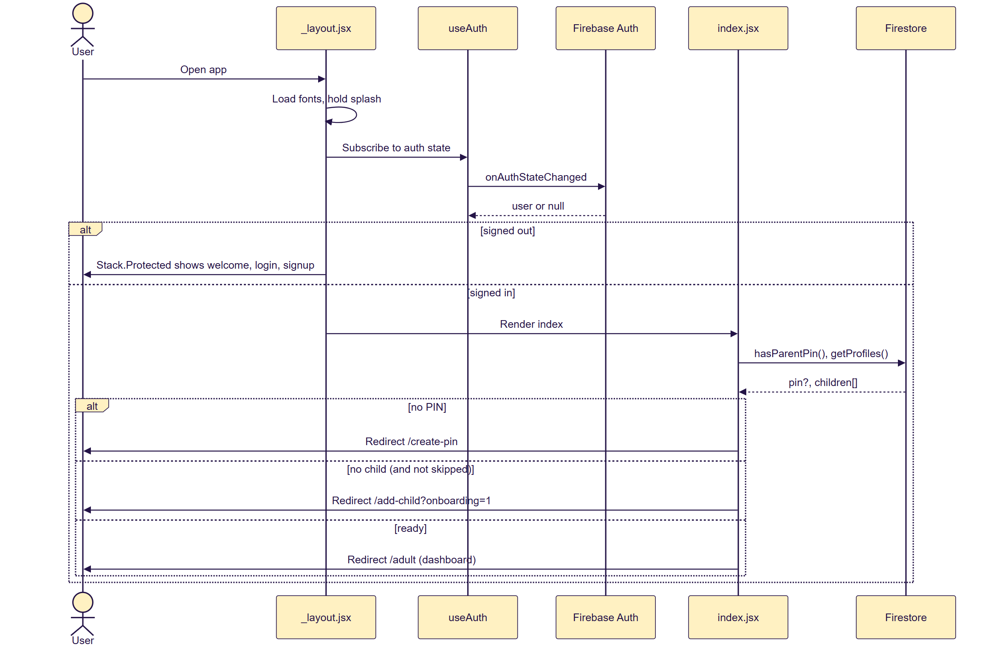</p>

The root layout uses `Stack.Protected` with a `guard={!!user}`. When the auth state flips, Expo Router redirects automatically, so there is no manual "if logged in" code in each screen. The sign-in is held **in memory only**, so every launch begins at the login screen, which suits a shared family device.

### 2. The "one data door" pattern

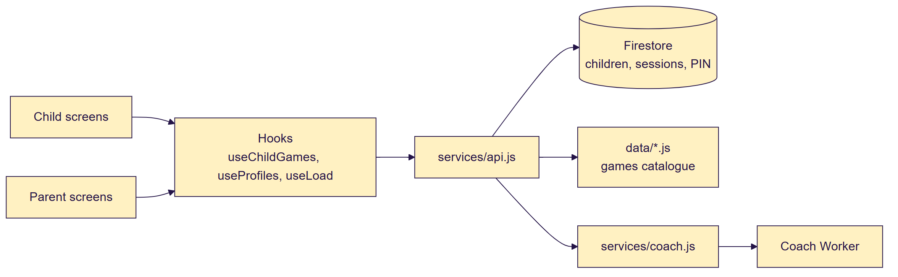

Every screen reads and writes through `src/shared/services/api.js`. Child screens only call `getEnabledGamesForChild`, so **a parent's switch applies everywhere at once**. If the data source changes (mock to Firestore, as it did during development), only `api.js` changes.

### 3. Playing a game and saving a session

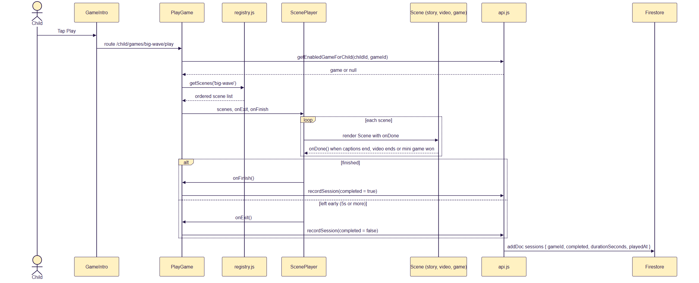

A failed save is only logged. **A network problem must never get in the child's way.** Leaving in under 5 seconds is not counted as a play.

### 4. Switching a game on for a child (parent to child)

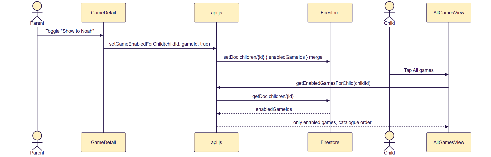

### 5. Component hierarchy of the child side

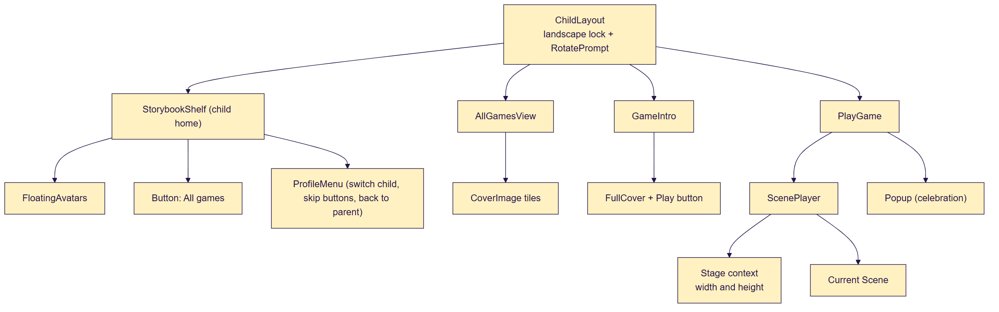

### 6. Component hierarchy of the parent side

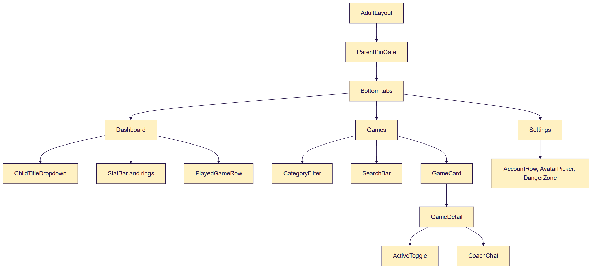

### 7. Shared UI primitives

Every screen on both sides is built from the same small kit in `src/shared/components/`:
`AppText` (typography and the 16px rule), `Button`, `IconButton`, `Icon`, `Modal`, `Popup`,
`Avatar`, `AvatarImage`, `CoverImage` and `Blobs` (the soft background shapes). This is what
keeps the app visually consistent and lets accessibility rules be enforced in one place.

## Navigation and routing

Routes live in `src/app/`. Each file is a thin wrapper that re-exports a page from `child/pages` or `adult/pages`, so route code stays tiny and screens stay testable and reusable.

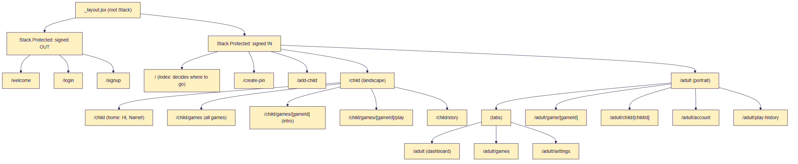

**Orientation is a function of the route.** The root layout reads the first URL segment: `child` locks to landscape, anything else to portrait. No screen needs to think about it.

## The game engine

Games are not hard coded screens. They are **an ordered list of scenes** played by a reusable engine in `src/games/engine/`. A new game needs only its own folder and one line in the registry.

| Piece | Responsibility |
|-------|----------------|
| `registry.js` | Maps a game id to its scene list. A game with no entry shows a "game goes here" placeholder. |
| `ScenePlayer` | Plays scenes in order, full screen. Provides the stage size, close button, optional skip buttons and fade transitions. |
| `Stage` | A React context with the stage width and height so scenes can lay out responsively. |
| `StoryScene` | Picture plus captions, a Next arrow when the last line has been shown. |
| `SpokenStillScene`, `ZoomStillScene` | A still picture with timed captions, or a slow zoom, then moves on by itself. |
| `VideoScene`, `SpokenVideoScene`, `LoopingVideoScene`, `BreathingVideoScene` | Video based scenes, including a looping breathing guide. |
| `Captions` and `useSpokenLines` | Show each line of text timed by estimated reading time. (Despite the name, no voice is played.) |
| `timing.js` | Pure functions that turn lines of text into a timeline (`timeLines`, `lineAt`, `estimatedEnd`). |
| `Narration` | A timer clock that drives captions and scene length (a timer, not audio). |
| `useBlowDetector` | Reads microphone loudness and returns `{ status, level }`. |
| `FitImage`, `NextButton` | Image fitting and the shared Next control. |

**The scene contract is one prop.** Every scene receives `onDone`. It calls it when the captions have been read, the video ends or the mini game is won, and the next scene fades in. A guard in `ScenePlayer` ignores `onDone` calls from a scene that has already been skipped away from, so the story cannot jump twice.

<p align="center">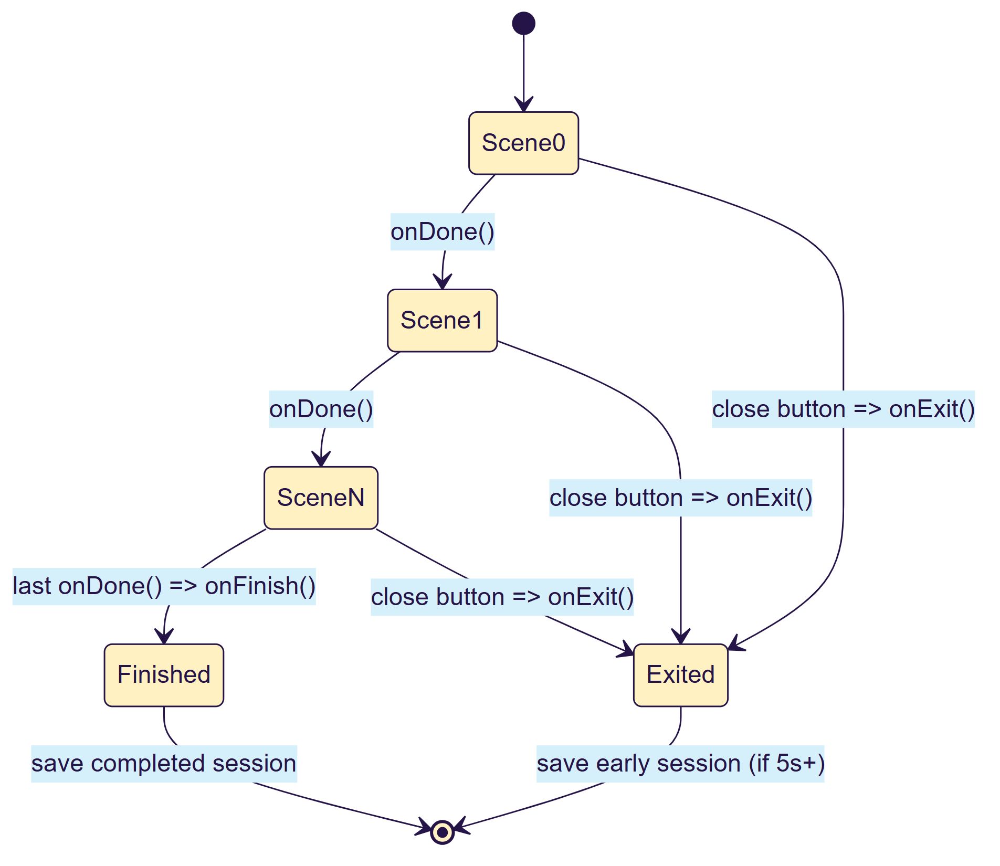</p>

### Microphone blow detection

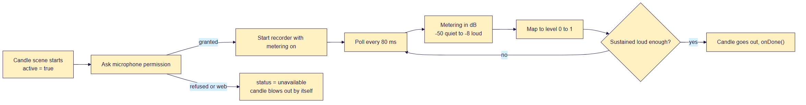

Nothing is recorded for playback, stored or sent. The permission text shown to the user says exactly this.

## The Big Wave: scene by scene

The running order lives in `src/games/game1-big-wave/scenes.js`. There are **18 scenes** made of five types.

| # | Scene | Type | Interaction | Skill reinforced |
|---|-------|------|-------------|------------------|
| 1 | Intro in the woods | story | Listen | Setting the scene |
| 2 | The edge of the woods | still | Listen | |
| 3 | Breathe and blow out the candle | video | **Blow** into the mic | Paced breathing |
| 4 | Through the forest | video | Watch | |
| 5 | Forest path | game | **Drag** Cami along the path | Fine motor, focus |
| 6 | The pile of wood | zoom still | Watch | Naming the problem |
| 7 | Candle again | video | **Blow** | Breathing before action |
| 8 | Cami and the pile of wood | story | Listen | Small-steps thinking |
| 9 | Clear the path | game | **Drag** logs one by one | Small steps add up |
| 10 | After the logs are cleared | video | Watch | Reward |
| 11 | Jump the 7 logs | game | **Tap** to jump | Persistence |
| 12 | Tripping over the log | video | Watch | Setbacks happen |
| 13 | Candle after the fall | video | **Blow** | Calm after a setback |
| 14 | The beach | video | Watch | |
| 15 | Build the sandcastle | game | **Tap** to build | Calm focused play |
| 16 | The big wave | video | Watch | The big feeling arrives |
| 17 | Breathing without the candle | video | **Breathe** along | Self regulation |
| 18 | Final clip | video | Watch | The calm was inside you |

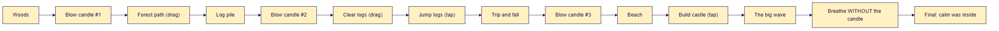

**Learning arc.** The candle appears three times as a prop. The last time, the child breathes with no candle at all. That is the point: the skill is internal and portable.

## Data model

Data is stored in **Cloud Firestore** as a tree owned by the parent. The game catalogue lives in code.

<p align="center">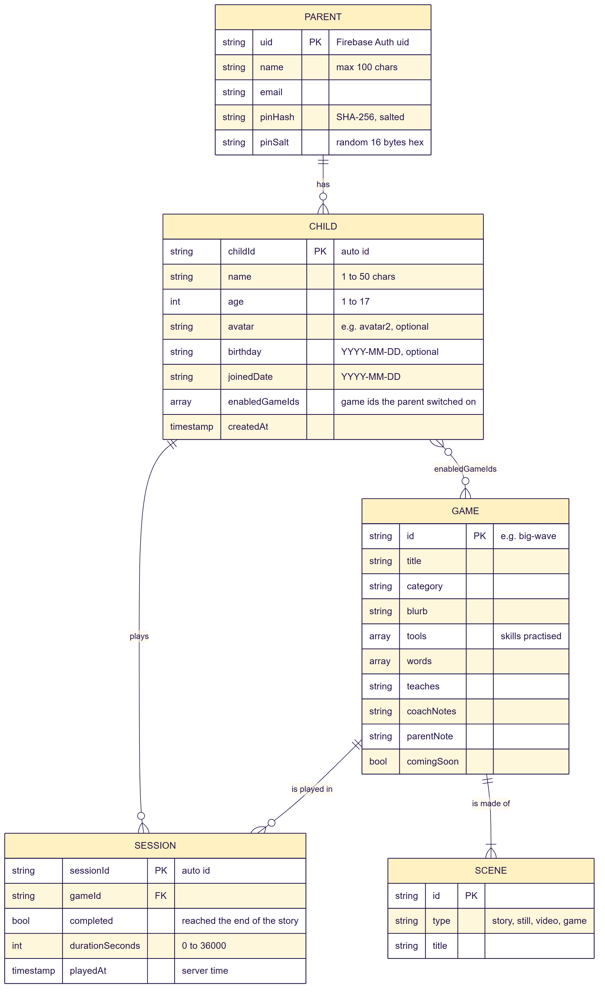</p>

**Where each entity lives**

| Entity | Storage | Path or file |
|--------|---------|--------------|
| Parent | Firestore | `parents/{uid}` |
| Child | Firestore | `parents/{uid}/children/{childId}` |
| Session | Firestore | `parents/{uid}/children/{childId}/sessions/{sessionId}` |
| Game | Code | `src/shared/data/games.js` |
| Scene | Code | `src/games/game1-big-wave/scenes.js` |
| Settings and current child | Device | AsyncStorage via `persistedStore` |

**Design choice: a subcollection tree.** Nesting children and sessions under the parent means one rule, "`request.auth.uid == uid`", protects everything below it, and deleting an account is one clean sweep.

**Design choice: the game catalogue is data in code, not in the database.** The catalogue is the same for every family, changes with app releases, and keeps the child side fast and offline friendly. Only per child choices (`enabledGameIds`) are stored.

### Firestore hierarchy

<p align="center">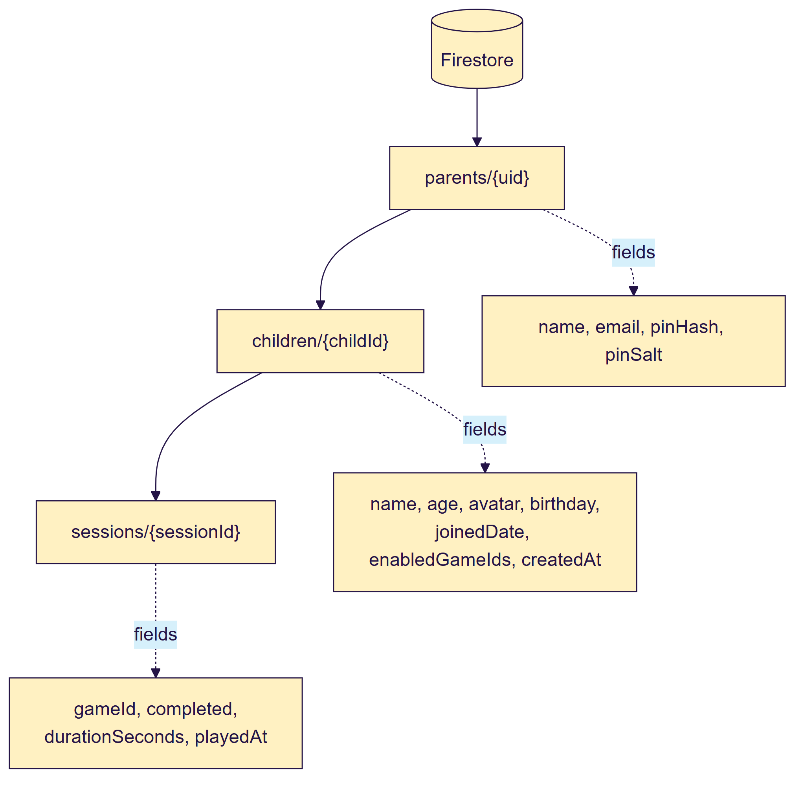</p>

## Security and privacy

Security is a feature, because the users are children.

| Threat | Defence |
|--------|---------|
| A child enters the parent area | 4 digit PIN gate between the sides, 5 wrong tries locks it for 30 seconds |
| The PIN is stolen from the database | Only a **salted SHA-256 hash** is stored, with a fresh random 16 byte salt, never the digits |
| One family reading another family's data | `firestore.rules` allow access only when `request.auth.uid == uid`, everything else is `allow read, write: if false` |
| Bad or oversized data written | Rules validate name length, age 1 to 17, avatar string size, session duration cap (36000 s) and field whitelists with `hasOnly` |
| Cheating or editing play history | Sessions are **create only**: `allow update: if false`, and `playedAt` must equal `request.time` |
| The Gemini API key leaks from the app | The key lives only as a Cloudflare **secret**. The app never sees it |
| Strangers abusing the AI coach | The Worker verifies the Firebase **ID token (JWT)** against Google's public keys with `jose` before answering |
| Prompt injection through child or game fields | Context is wrapped in `<context>` tags and the system prompt tells the model to treat it as information, not instructions. Field lengths are clipped |
| Microphone privacy | Only loudness is read. The permission text states nothing is kept or sent. Refusing the mic still lets the child finish |
| Shared device | Auth persistence is in memory, so every launch starts signed out |
| Account removal | The delete-account button removes the parent record and everything under it |
| Firebase config in the repo | Web config values identify the project and are not secrets. Protection comes from sign-in and rules |

<p align="center">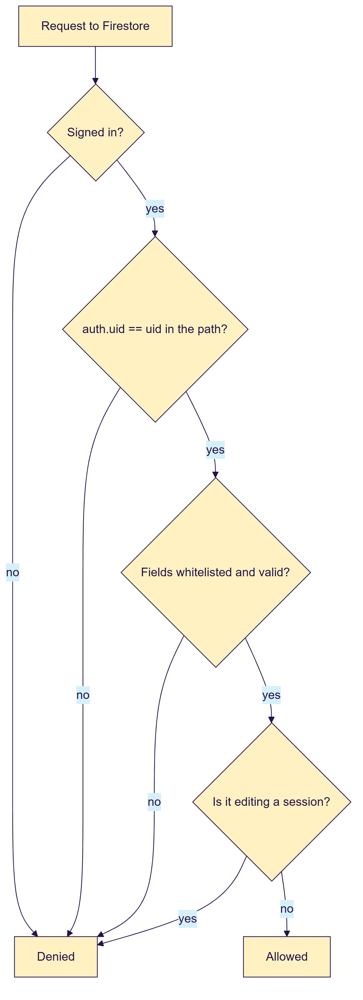</p>

## The AI parent coach

The coach helps a grown-up play a game with their child and suggests follow up activities. It is intentionally narrow: it is not a therapist and says so.

<p align="center">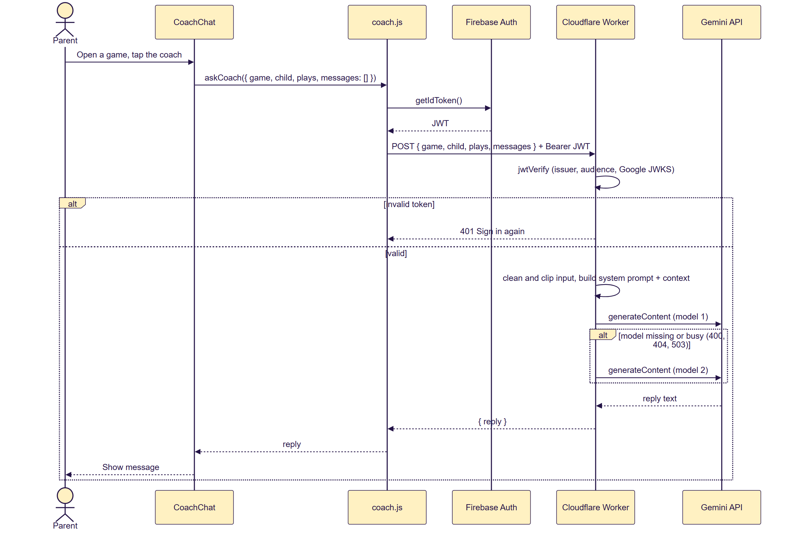</p>

**Worker design details**
- **Model fallback.** Free tier models are tried in order, so if one is retired or busy the next answers.
- **20 second timeout** per model so a hanging model does not freeze the parent.
- **Limits.** The last 20 messages are kept, each at most 2000 characters. Output is capped at 1500 tokens.
- **Grounding.** The prompt receives the game's skills, parent note and the designers' `coachNotes`, plus the child's name and play counts.
- **Age pitch.** Advice is aimed at ages 4 to 5, with a bracketed note once per reply.
- **Safety.** Serious concerns are met with kindness and a pointer to a professional. Off topic questions are politely redirected.
- **Opening message.** With no messages, the Worker supplies a standard "how can I play this together" opening.

## Design


## Use cases

<p align="center">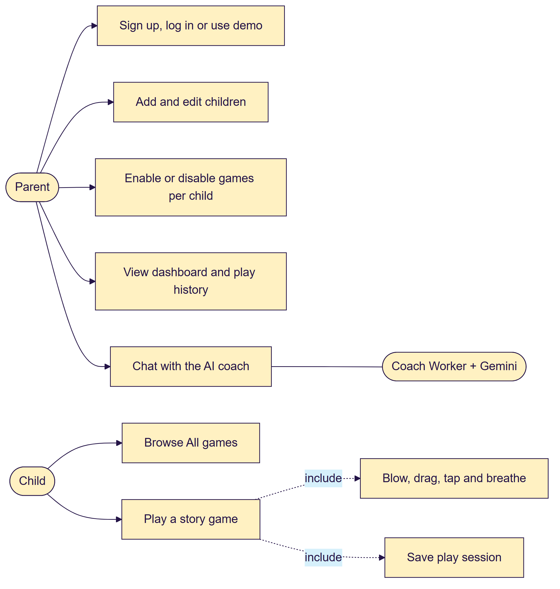</p>

| Use case | Actor | Main flow | Alternate flows |
|----------|-------|-----------|-----------------|
| **Set up and choose games** | Parent | Sign up, create a PIN, add a child, open the Games tab, switch a game on for that child | Skip adding a child and do it later. A "coming soon" game cannot be switched on |
| **Play The Big Wave** | Child | Home, All games, pick the tile, Play, watch, blow, drag, tap and breathe to the end, celebration popup | Mic refused: the candle blows out by itself. Leaving after 5 seconds or more saves a not completed session |
| **Get ideas from the coach** | Parent | Open a game, ask the coach, read the opening recommendation, ask follow-ups | Invalid token: asked to sign in again. Coach busy or offline: friendly error |

## Key code snippets

**Adding a game takes one line** (`src/games/registry.js`)

```js
import { bigWaveScenes } from './game1-big-wave/scenes.js';

const playableGames = { 'big-wave': bigWaveScenes };

export function getScenes(gameId) {
  return playableGames[gameId] ?? null; // null means the "game goes here" placeholder
}
```

**A game is just an ordered list** (`src/games/game1-big-wave/scenes.js`)

```js
export const bigWaveScenes = [
  { id: '00',  type: 'story', title: 'Intro in the woods',      Scene: Intro },
  { id: '01c', type: 'video', title: 'Blow out the candle',     Scene: CandleBlow },
  { id: '05',  type: 'game',  title: 'Clear the path (drag)',   Scene: ClearLogs },
  // ...
];
```

**Route protection in one place** (`src/app/_layout.jsx`)

```jsx
<Stack.Protected guard={!!user} redirectTo="/welcome">
  <Stack.Screen name="child" />
  <Stack.Screen name="adult" />
</Stack.Protected>
<Stack.Protected guard={!user}>
  <Stack.Screen name="welcome" />
  <Stack.Screen name="login" />
</Stack.Protected>
```

**Salted PIN hashing** (`src/shared/services/pin.js`)

```js
const hash = (pin, salt) =>
  Crypto.digestStringAsync(Crypto.CryptoDigestAlgorithm.SHA256, `${salt}:${pin}`);

export async function setParentPin(pin) {
  const pinSalt = await newSalt(); // 16 random bytes
  await setDoc(parentRef(), { pinSalt, pinHash: await hash(pin, pinSalt) }, { merge: true });
}
```

**Server side token check** (`worker/src/index.js`)

```js
await jwtVerify(token, keys, {
  issuer: `https://securetoken.google.com/${projectId}`,
  audience: projectId,
});
```

**Immutable play history** (`firestore.rules`)

```
match /sessions/{sessionId} {
  allow create: if request.auth.uid == uid
    && request.resource.data.keys().hasOnly(['gameId','completed','durationSeconds','playedAt'])
    && request.resource.data.playedAt == request.time;
  allow update: if false;
}
```

**A tiny reactive store with persistence** (`src/shared/state/persistedStore.js`)

```js
const settings = createPersistedStore('tiny-giants:settings', { skip: false });
// any screen: const { skip } = useSettings();  setSetting('skip', true);
```

## Challenges and how they were solved

| Challenge | Solution |
|-----------|----------|
| Detecting a child blowing into a phone | `useBlowDetector` reads microphone metering in dB every 80 ms, maps -50 to -8 dB onto a 0 to 1 level and treats a sustained spike as a blow. Nothing is recorded or sent, and there is a graceful fallback. |
| Keeping captions and video in sync | `timing.js` builds a timeline from the text and `useSpokenLines` drives captions from it, so scene length follows reading time. |
| Keeping the AI key safe | A Cloudflare Worker holds the key and verifies the parent's Firebase token with Google's public keys before answering. |
| Keeping children out of parent screens | Separate route groups plus a hashed, rate limited PIN gate. |
| Keeping one family's data away from another | Hierarchical Firestore data with rules that tie every read and write to `auth.uid`. |
| Scenes advancing twice (skip then finish) | `ScenePlayer` tracks the current scene id and ignores `onDone` from any other scene. |
| Large video files | Short clips, with some video replaced by audio, stills and code drawn SVG art. |
| Models being retired by the AI provider | The Worker tries a list of models in order and handles 400, 404, 503 and timeouts. |
| Children's lack of reading ability | Captions, large icons and picture tiles, and games built around doing rather than reading. |
| Two orientations in one app | Orientation is derived from the route's first segment and applied by a single hook. |
| Showing the app on a desktop | A `PrototypeShell` renders the app inside a phone mockup on desktop browsers and tells it which way to rotate. |
| A new family has no data to look at | A shared demo account that re-creates its PIN and two children each time it is used. |

## Testing and quality

```bash
npm test        # Jest with jest-expo
npm run lint    # ESLint with eslint-config-expo
```

| Test file | What it covers |
|-----------|----------------|
| `authValidation.test.js` | Email shape, sign in and sign up rules, password length and match, child form checks |
| `persistedStore.test.js` | The persisted store reads saved state, merges, notifies listeners and saves changes |

Validation and storage logic are written as **pure functions** with no Firebase or React inside, which is what makes them quick to test.

**Other quality practices**
- UX review with a lecturer, with the feedback applied to the interface.
- Feedback from classmates during development.
- Firestore rules reasoned through per field, not left open.
- Early prototype built in Vite (`web-vite-prototype/`) to validate the original open-book idea before moving to Expo (the book was later simplified into the current home screen and All games button).

## Deployment

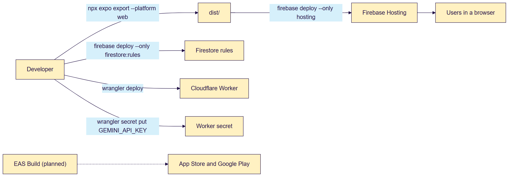

```bash
npx expo export --platform web
npx firebase deploy --only hosting
npx firebase deploy --only firestore:rules
```

## Diagram library

Visual diagrams for the presentation are kept in `docs/diagrams/` as PDFs. The exact prompts used to generate each one are in [`docs/DIAGRAM-PROMPTS.md`](docs/DIAGRAM-PROMPTS.md). Mermaid versions of most of them are already rendered in this README.

| # | Diagram | File | Use it to explain |
|---|---------|------|-------------------|
| 1 | System architecture | `docs/diagrams/01-system-architecture.pdf` | Big picture, tech stack, who talks to whom |
| 2 | Layered code architecture | `docs/diagrams/02-layered-architecture.pdf` | Code organisation |
| 3 | Entity relationship diagram | `docs/diagrams/03-erd.pdf` | Data model |
| 4 | Use case diagram | `docs/diagrams/04-use-cases.pdf` | Who does what |
| 5 | User flow | `docs/diagrams/05-user-flow.pdf` | Journeys for parent and child |
| 6 | Sitemap and navigation | `docs/diagrams/06-sitemap.pdf` | Screens and routes |
| 7 | Component hierarchy | `docs/diagrams/07-component-tree.pdf` | How components compose |
| 8 | Game engine | `docs/diagrams/08-game-engine.pdf` | Reusable scene engine |
| 9 | Sequence: play and save | `docs/diagrams/09-seq-play-session.pdf` | Runtime interaction |
| 10 | Sequence: AI coach | `docs/diagrams/10-seq-ai-coach.pdf` | Security of the AI flow |
| 11 | Security model | `docs/diagrams/11-security.pdf` | Defence in depth |
| 12 | Big Wave story map | `docs/diagrams/12-story-map.pdf` | Learning arc |
| 13 | Tech stack | `docs/diagrams/13-tech-stack.pdf` | What it is written with |
| 14 | Deployment | `docs/diagrams/14-deployment.pdf` | How it ships |

## Conclusion and future work

**Highlights**
- A complete first game with real interaction (microphone, drag, tap).
- A secure parent side with a PIN gate, per child control and an AI coach.
- A reusable engine, so the next games are mostly content, not code.
- Privacy and safety designed in from the start, not added at the end.

**Challenges.** Synchronising captions and video; keeping media small enough for mobile; designing for a very young audience while giving parents useful controls; and keeping an AI feature safe and affordable.

**Future improvements**
- Finish *The Kind Detective* and *Memory Garden*
- Replace the remaining placeholder video with final art, and consider adding voiceover and sound
- Optional AI generated summaries of play, only after a careful safety and privacy review
- More languages and voice options
- Offline play
- A store release through EAS Build and Submit
- Parent reminders and shared sessions

## License

Copyright 2026 Danae Swart. **All rights reserved.** This code is shared for assessment and
portfolio purposes only; it may not be copied, distributed or used to create derivative works
without written permission.

## Author

**Danae Swart**
- GitHub: [@danaeswart](https://github.com/danaeswart)
- Email: 241022@virtualwindow.co.za

## Acknowledgements

- [Expo documentation](https://docs.expo.dev) and [Expo Router](https://docs.expo.dev/router/introduction/)
- [React Native](https://reactnative.dev), [Firebase](https://firebase.google.com/docs), [Cloudflare Workers](https://developers.cloudflare.com/workers/)
- [Google Gemini](https://ai.google.dev) for the coach
- [Google Fonts](https://fonts.google.com): Poppins and DM Mono
- [skillicons.dev](https://skillicons.dev) and [shields.io](https://shields.io) for badges
- **Open Window**, for the education, facilities and the opportunity to develop this project
- Claude (Anthropic) as an AI coding assistant
- Feedback from my classmates
